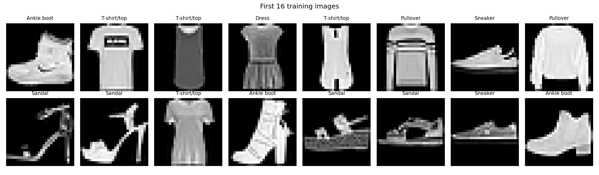
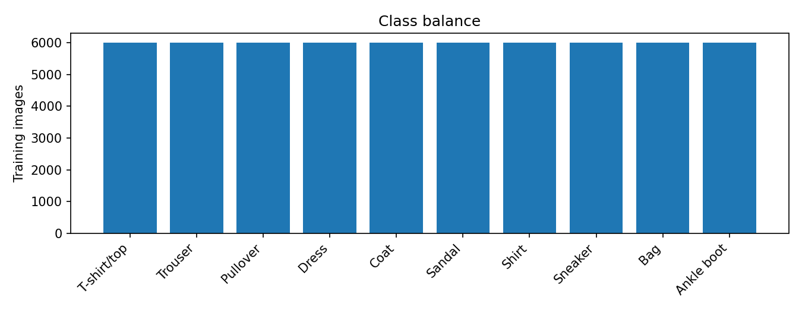
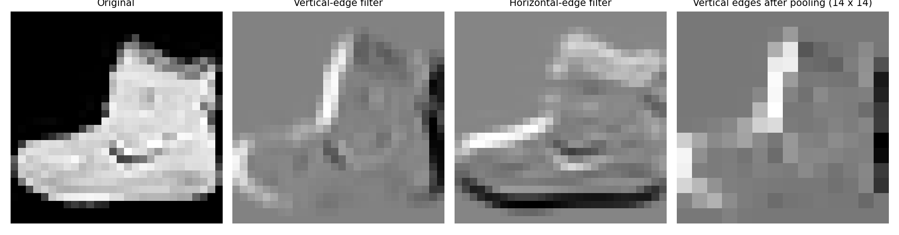
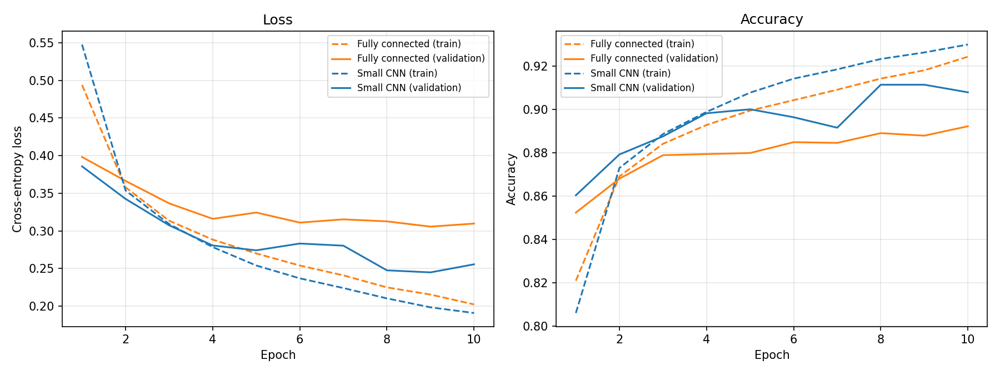
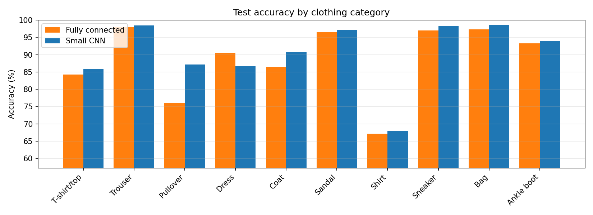
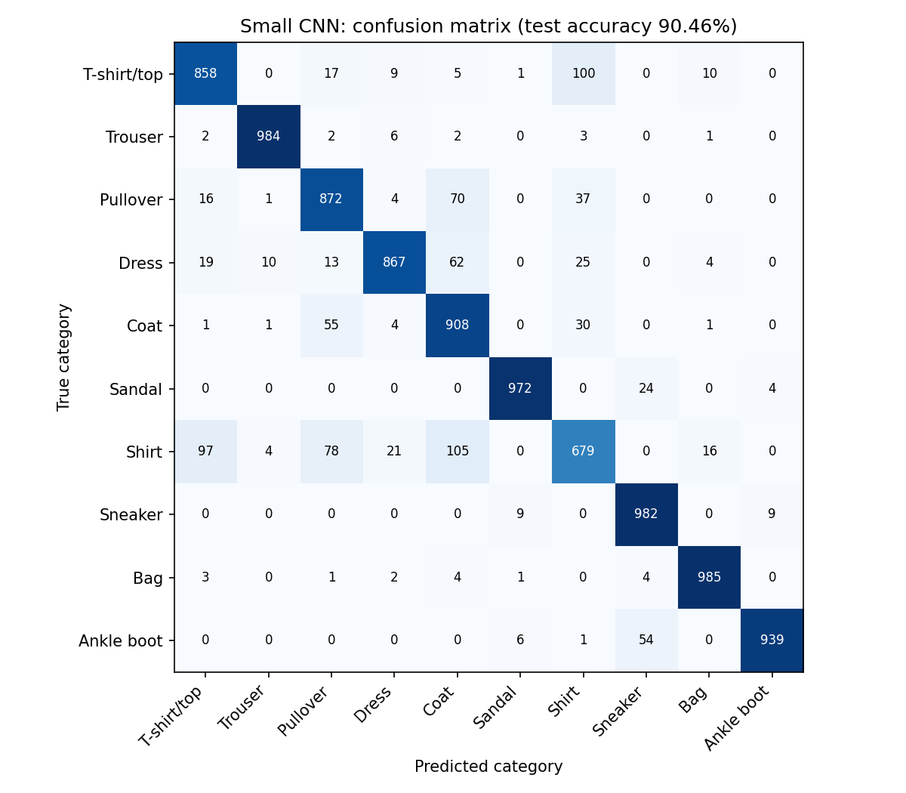
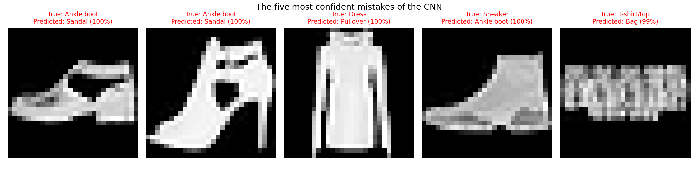

# Assignment 3: Build and Evaluate a CNN

**Notebook:** [assignment3_cnn_fashion_mnist.ipynb](assignment3_cnn_fashion_mnist.ipynb)

## Goal
Show that a small convolutional neural network (CNN) recognises clothing images better than a fully connected network, and understand where it still fails.

## Data
Fashion-MNIST: 70,000 grayscale images of 28 x 28 pixels in 10 clothing categories (60,000 for training, 10,000 for testing). I set aside 6,000 training images as a validation set. Pixels are normalised with the mean and standard deviation of the training images only.

## How it works
1. **Load and visualise** the images, and check that the classes are balanced.
2. **Convolution demo:** a hand-made edge filter slid over an image shows what a convolution, padding and max pooling do.
3. **Two models**, trained the same way (Adam, learning rate 0.001, 10 epochs):
   - Fully connected baseline: 784 -> 256 -> 128 -> 10. It flattens the image, so it ignores which pixels are neighbours.
   - Small CNN: 2 x (Conv 3x3 + ReLU + MaxPool), then Linear 64 -> 10. Filters look at small neighbourhoods and reuse the same weights everywhere, so it needs fewer parameters and can pick up edges and shapes.
4. **Training and validation curves** for both models. A growing gap between them means overfitting.
5. **Evaluation on the test set:** accuracy, per-class accuracy, confusion matrix.
6. **Error analysis:** the five most confident mistakes and why the model confused them.

## Results

| Model | Parameters | Best validation accuracy | Test accuracy |
|---|---|---|---|
| Fully connected baseline | 235,146 | 89.22% | 88.65% |
| Small CNN | 105,866 | 91.13% | 90.46% |

- The CNN is **1.81 points better** on the test set while using only 45% as many parameters.
- Gap between training and validation accuracy in the last epoch: 3.2 points (fully connected) and 2.2 points (CNN). The CNN overfits a little less.
- Easiest category for the CNN: Bag (98.5%). Hardest: Shirt (67.9%).
- Most common CNN mistake: Shirt predicted as Coat.

## Five misclassified examples

WRITE here, in your own words, one or two sentences for each of the five images: what the item really is, what the model predicted, and what visual feature (shape, sleeves, collar, straps) made them look alike.

## Conclusion
The CNN beat the fully connected network (90.46% against 88.65%) with less than half the parameters, because convolution filters reuse the same weights across the image and look at neighbouring pixels together, while the fully connected network flattens the image and treats every pixel separately. Both models still struggle with upper-body clothing: shirts are often confused with coats, T-shirts and pullovers, because at 28 x 28 pixels these items have almost the same shape and only differ in small details such as collars and buttons. Footwear and bags are recognised much more reliably because their outlines are very distinct.
