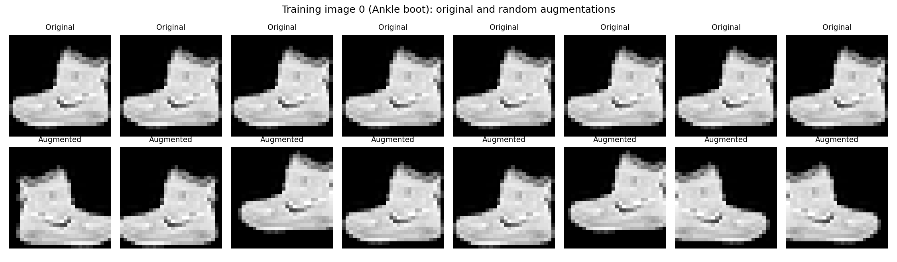
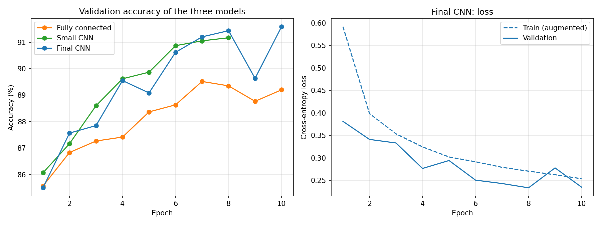
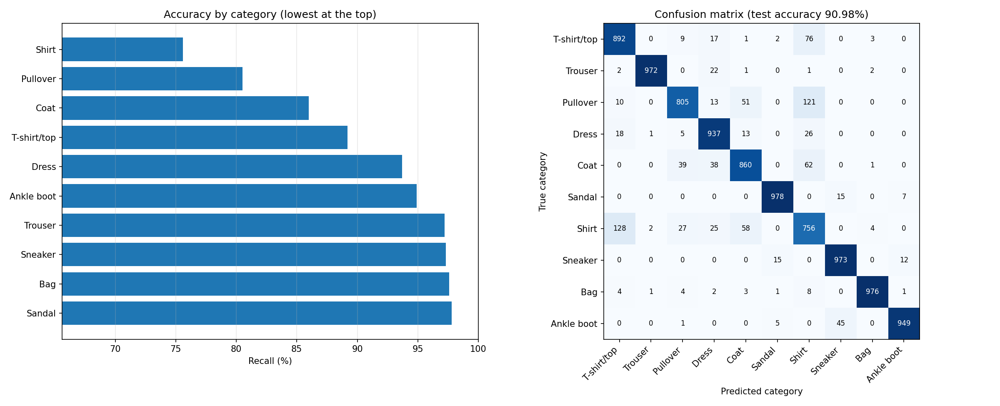
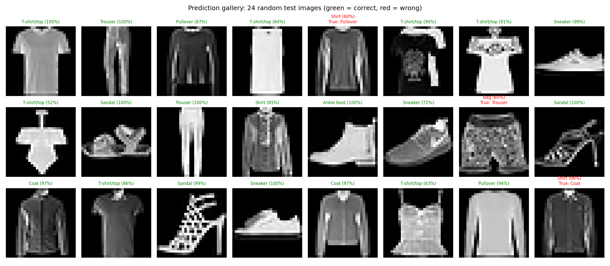
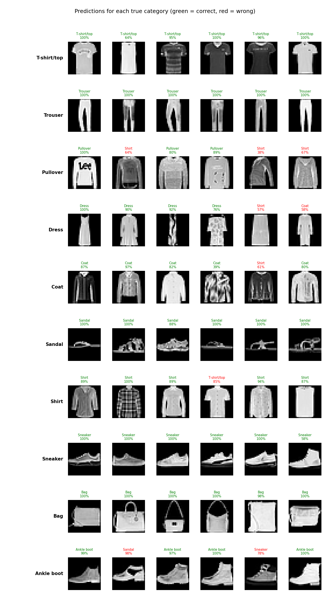
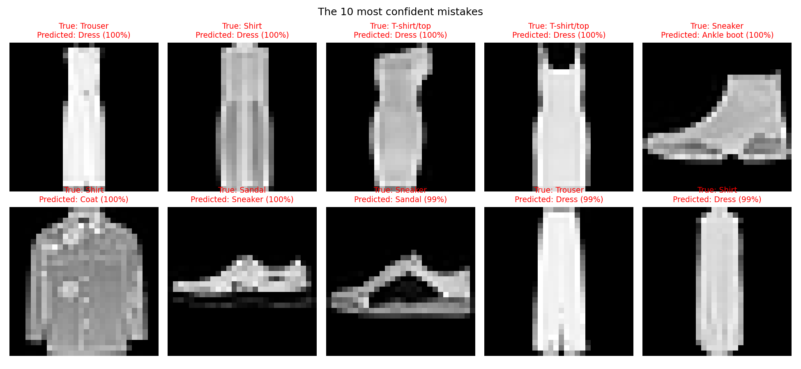

# Mini Project 3: Fashion Item Recognition

**Notebook:** [mini_project3_fashion_item_recognition.ipynb](mini_project3_fashion_item_recognition.ipynb)
**Saved model:** [fashion_cnn.pth](fashion_cnn.pth) (details in `model_info.json`)

## Goal
Build a classifier for clothing categories (shirts, trousers, bags, footwear and more) and compare three models.

## How it works
1. **Data:** Fashion-MNIST, split 54,000 train / 6,000 validation / 10,000 test. The training copy uses light augmentation (random horizontal flip and small shifts); validation and test images are never changed.
2. **Three models**
   - Fully connected network (baseline)
   - Small CNN (2 convolution layers)
   - Final CNN: three Conv + BatchNorm + ReLU + MaxPool blocks (32, 64 and 128 filters), then Dropout and a classifier layer
3. **Model choice:** the best model is picked by **validation** accuracy; the test set is used only for the final numbers.
4. **Outputs:** comparison table, prediction gallery, per-category gallery, confusion matrix, most confident mistakes, and the saved model (reloaded and checked to give identical accuracy).



## Comparison table

| Model | Parameters | Augmentation | Epochs | Validation accuracy | Test accuracy | Wrong (of 10,000) | Training time |
|---|---|---|---|---|---|---|---|
| Fully connected | 235,146 | No | 10 | 89.52% | 88.37% | 1163 | 173 s |
| Small CNN | 105,866 | No | 8 | 91.17% | 90.88% | 912 | 237 s |
| Final CNN | 241,994 | Yes | 10 | 91.58% | 90.98% | 902 | 767 s |

## Results
- The final CNN reached **90.98%** test accuracy (902 wrong out of 10,000). That is 2.61 points better than the fully connected baseline and only 0.10 points better than the small CNN.
- Easiest category: Sandal (97.8%). Hardest: Shirt (75.6%).
- Most common mistake: Shirt predicted as T-shirt/top (128 times).




## Prediction gallery



## Mistakes


WRITE here, in your own words, two or three sentences: which kinds of items the model confuses and why.

## Conclusion
Convolutional networks clearly beat the fully connected network (about 90.9% against 88.4%), so using the 2D structure of the image matters more than adding parameters. The final CNN, with batch normalisation, dropout and augmentation, was only 0.10 points better than the small CNN, which is a very small difference, and it took about three times longer to train (767 s against 237 s). For this dataset the small CNN is nearly as good for much less cost. All three models share the same weakness: upper-body items (shirt, T-shirt/top, pullover, coat) look alike at 28 x 28 pixels, so these are where most errors occur.

## Run it
```
pip install torch torchvision numpy matplotlib
jupyter nbconvert --to notebook --execute --inplace mini_project3_fashion_item_recognition.ipynb
```
