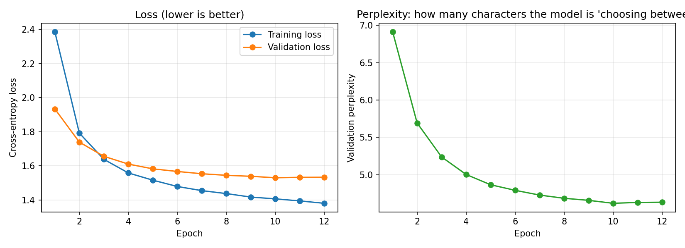

# Mini Project 3 (second option): LSTM Text Generator with a Streamlit App

A character-level LSTM learns the style of a text corpus (here: Shakespeare, or any poems, lyrics or code you choose) and writes new text one letter at a time. A Streamlit web app lets anyone set the **temperature** and the **maximum length**.

## How it works
1. **Prepare the text** (`utils.py`): every character gets a number. The text is split 90% for training and 10% for validation, in order, never shuffled.
2. **Training examples:** a random window of 100 characters is the input. The same window shifted by one character is the answer, so at every position the model learns "given everything so far, what comes next?".
3. **Model** (`common.py`): Embedding (64) -> 2 LSTM layers (256 units, dropout 0.3) -> Linear layer with one score per character. The LSTM keeps a memory of what it has read.
4. **Training** (`train.py`): CrossEntropyLoss, Adam, gradient clipping, learning-rate halving when validation stops improving. The best model on validation data is saved to `model.pt` together with the vocabulary.
5. **Generation** (`generator.py`): the model reads the start text, gets probabilities for the next character, one is chosen at random, and it is fed back in. This repeats until the maximum length.
6. **Temperature** (`utils.sample_from_logits`): the scores are divided by the temperature before the probabilities are computed. Below 1 the model plays safe and repeats itself; above 1 it takes risks and makes more spelling mistakes. Top-k optionally limits the choice to the k likeliest letters.
7. **App** (`app.py`): sliders for temperature, max length and top-k, a start-text box, a repeatable-result option, a download button, and a tab that compares three temperatures side by side.

## Run it
```
pip install -r requirements.txt
python download_corpus.py
python train.py --quick       # about 1 minute, checks that everything works
python train.py               # the real run
streamlit run app.py
```
Command-line generation without the web page: `python generate.py --seed "ROMEO:" --length 400 --temperature 0.8`

Use your own text: `python train.py --corpus my_lyrics.txt`

## Results
PASTE the training lines from the terminal here (the last epoch, with train loss, val loss and perplexity), and fill the table below.

| Temperature | What I saw |
|---|---|
| 0.3 | Correct spelling and line layout, but it repeats phrases such as "the sentence that" and gets stuck in a loop |
| 0.8 | WRITE |
| 1.2 | WRITE |



Generated samples: see [samples.md](samples.md).

## Screenshot of the app
ADD a screenshot named `app_screenshot.png` to this folder, then replace this line with:
``

## Conclusion
WRITE 2 to 3 sentences: what the model learned well (spelling, line breaks, speaker names), what it gets wrong (meaning, long-range sense), and what temperature did.

## Files
| File | Purpose |
|---|---|
| `download_corpus.py` | downloads the text |
| `train.py` | trains and saves `model.pt` |
| `generator.py`, `generate.py` | text generation (library and command line) |
| `app.py` | Streamlit app |
| `common.py`, `utils.py`, `report.py` | model, helpers, plots |
