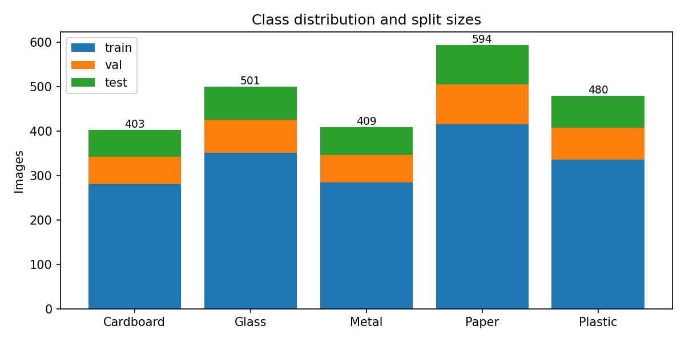
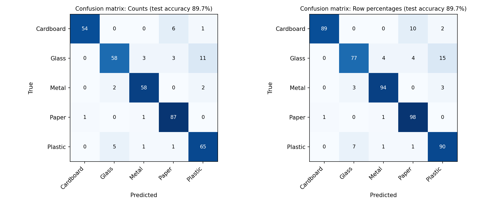
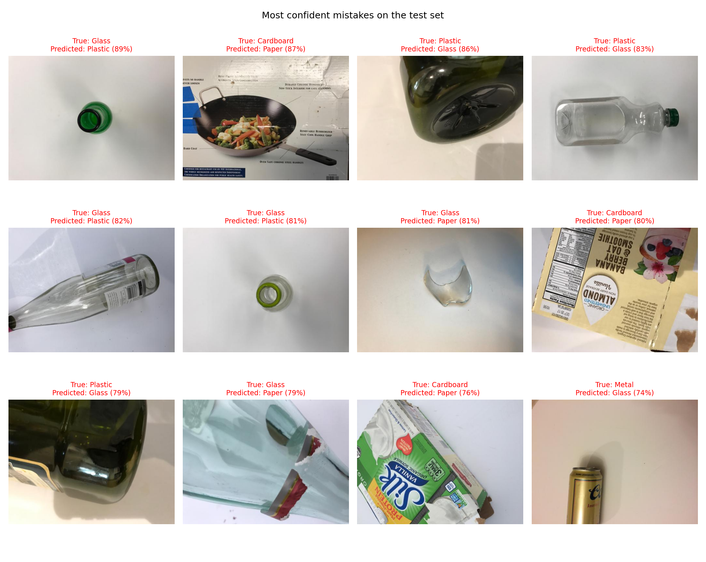

# Assignment 4: Final Model Evaluation

The full evaluation report is in **[evaluation_report.md](evaluation_report.md)**. It was produced by `evaluate.py` from the [Major Project](../Major-Project/) and then edited by me.

## 1. Dataset
- **Source:** TrashNet (Thung and Yang, Stanford, 2016), https://github.com/garythung/trashnet
- **Categories (5):** cardboard, glass, metal, paper, plastic (the `trash` category was left out because it is small and vague)
- **Duplicates:** 3 exact duplicate files removed; 33 groups of near-identical photos (151 images) were kept together in one split. The leakage check found 0 identical and 0 near-identical images across splits.

| Category | Train | Validation | Test | Total |
|---|---|---|---|---|
| Cardboard | 281 | 61 | 61 | 403 |
| Glass | 351 | 75 | 75 | 501 |
| Metal | 285 | 62 | 62 | 409 |
| Paper | 416 | 89 | 89 | 594 |
| Plastic | 336 | 72 | 72 | 480 |
| **Total** | **1669** | **359** | **359** | **2387** |

## 2. Model configurations

| Configuration | Input size | Augmentation | Epochs | Parameters | Training time | Best val. accuracy | Test accuracy |
|---|---|---|---|---|---|---|---|
| Baseline CNN | 128 px | No | 15 | 1,072,549 | 320 s | 70.8% | 69.6% |
| Improved CNN | 128 px | Yes | 25 | 390,181 | 1278 s | 76.0% | 74.9% |
| Pretrained MobileNetV2 (final model) | 224 px | Yes | 8 | 2,230,277 | 771 s | 91.1% | 89.7% |

The best model was chosen by validation accuracy. The test set was used only once for the final numbers.

## 3. Training and validation graphs

The baseline overfits strongly (training accuracy about 99.8%, validation about 69%). The improved CNN overfits less but its validation curve is noisy because the validation set is small. The pretrained model improves smoothly.

## 4. Final test results
**Final model: Pretrained MobileNetV2, test accuracy 89.7%** (37 wrong out of 359 images).

| Category | Precision | Recall | Test images |
|---|---|---|---|
| Cardboard | 98.2% | 88.5% | 61 |
| Glass | 89.2% | 77.3% | 75 |
| Metal | 92.1% | 93.5% | 62 |
| Paper | 89.7% | 97.8% | 89 |
| Plastic | 82.3% | 90.3% | 72 |

## 5. Failure examples and suggested improvements
The model made 37 mistakes on 359 test images. The most common were Glass predicted as Plastic (11 times), Cardboard predicted as Paper (6) and Plastic predicted as Glass (5). Glass accounts for 17 of the 37 mistakes. Glass and plastic bottles are often transparent, shiny and similarly shaped, so in a small photo they look alike; cardboard and paper are both flat, fibrous and similar in colour. 8 of the 37 mistakes had a score of 80% or more, so a high score does not mean the answer is correct.

1. **Glass predicted as Plastic (89%).** This is a green glass bottle photographed from directly above, so only a small green ring is visible on a white background. The bottle's shape is hidden, and a plain round opening could just as well be the neck of a plastic bottle.

2. **Plastic predicted as Glass (83%).** This is a clear plastic bottle with a green cap, lying on a white background. Transparent and shiny, with a bottle outline, it looks like a glass bottle, which is the confusion glass and plastic have the most in this dataset.

3. **Cardboard predicted as Paper (87%).** The picture is mainly a printed box with a wok and vegetables on it, covered in printed text and colour. The model sees printed, flat white-and-grey material rather than the rough brown texture of plain cardboard, so it chooses Paper.

Suggested improvements:
1. Add more and more varied photos of glass (clear and coloured) and plastic bottles, to reduce the biggest confusion.
2. Add more cardboard and paper photos with different backgrounds and lighting.
3. Fine-tune more layers of MobileNetV2 or use a larger input size, to see fine differences such as texture and reflections.
4. Add an "unknown" option and calibrate the scores, because 8 of the 37 mistakes were made with a score of 80% or more.

## Conclusion
The pretrained MobileNetV2 was clearly the best model (89.7% test accuracy), 15 points above the improved CNN (74.9%) and 20 points above the baseline (69.6%). The baseline overfitted: its training accuracy reached about 99.8% while validation accuracy stayed near 69%. Augmentation, batch normalisation and dropout reduced this and gave about +5 points, but training from scratch on about 1,700 images is limited, whereas the pretrained model starts from features learned on millions of images.
