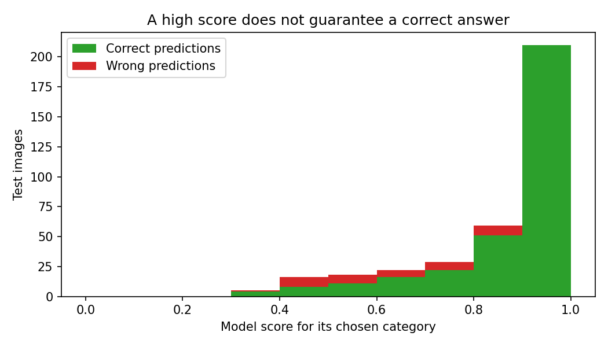

# Evaluation Report: Waste Image Classification

## 1. Dataset

- **Source:** TrashNet (Thung and Yang, Stanford, 2016) (https://github.com/garythung/trashnet)
- **Categories used (5):** Cardboard, Glass, Metal, Paper, Plastic
- **Images found:** 2390 in the selected categories
- **Exact duplicate files removed:** 3
- **Near-duplicate groups:** 33 groups containing 151 images. Each group was kept together in a single split.
- **Leakage check after splitting** (identical or near-identical images in different splits): 0 identical, 0 near-identical

| Category | Train | Validation | Test | Total |
|---|---|---|---|---|
| Cardboard | 281 | 61 | 61 | 403 |
| Glass | 351 | 75 | 75 | 501 |
| Metal | 285 | 62 | 62 | 409 |
| Paper | 416 | 89 | 89 | 594 |
| Plastic | 336 | 72 | 72 | 480 |
| **Total** | **1669** | **359** | **359** | **2387** |

## 2. Model configurations

| Configuration | Input size | Augmentation | Epochs | Parameters | Training time | Best val. accuracy | Test accuracy |
|---|---|---|---|---|---|---|---|
| Baseline CNN | 128 px | No | 15 | 1,072,549 | 320 s | 70.8% | 69.6% |
| Improved CNN | 128 px | Yes | 25 | 390,181 | 1278 s | 76.0% | 74.9% |
| Pretrained MobileNetV2 (final model) | 224 px | Yes | 8 | 2,230,277 | 771 s | 91.1% | 89.7% |

- **Baseline CNN:** 3 convolution layers and 2 dense layers, no augmentation, no regularisation.
- **Improved CNN:** 4 blocks of Conv + BatchNorm + ReLU + MaxPool, global average pooling, dropout 0.4, data augmentation (crop, flip, rotation, colour jitter) and weight decay.
- **Pretrained MobileNetV2:** MobileNetV2 pretrained on ImageNet: first only the new classifier is trained, then the last 4 blocks are fine-tuned. Same augmentation as the improved CNN.

The best model was chosen by **validation** accuracy. The test set was used only once for the final numbers.

## 3. Training and validation graphs

When the training line keeps improving but the validation line stops, the model is memorising the training images (overfitting).

## 4. Final test results

**Final model: Pretrained MobileNetV2. Test accuracy 89.7%** (37 wrong out of 359 test images).

| Category | Precision | Recall | F1 | Test images |
|---|---|---|---|---|
| Cardboard | 98% | 89% | 93% | 61 |
| Glass | 89% | 77% | 83% | 75 |
| Metal | 92% | 94% | 93% | 62 |
| Paper | 90% | 98% | 94% | 89 |
| Plastic | 82% | 90% | 86% | 72 |

Precision: of the images predicted as this category, how many were right. Recall: of the real images of this category, how many were found.

Most frequent mistakes:

| True category | Predicted as | Times |
|---|---|---|
| Glass | Plastic | 11 |
| Cardboard | Paper | 6 |
| Plastic | Glass | 5 |
| Glass | Paper | 3 |
| Glass | Metal | 3 |

## 5. Failure examples and error analysis

- Average score on correct predictions: 89%. On wrong predictions: 63%.
- **8 of the 37 wrong predictions had a score of 80% or more.** The model can be confidently wrong.

| Score range | Test images | Accuracy in that range |
|---|---|---|
| 0% to 50% | 21 | 57% |
| 50% to 60% | 18 | 61% |
| 60% to 70% | 22 | 73% |
| 70% to 80% | 29 | 76% |
| 80% to 90% | 59 | 86% |
| 90% to 100% | 210 | 100% |

### Suggested improvements (reword in your own words)

1. **Fix the biggest confusion first.** Glass was predicted as Plastic 11 times. Collect more and more varied photos of both and check that the labels are right.
2. **Add data for the weakest categories** (Glass, Cardboard). They have the lowest recall.
3. **Use photos from real situations.** Most public waste datasets show one object on a plain background. Add pictures with cluttered backgrounds, bad lighting and partly hidden objects.
4. **Add an 'unknown / not waste' option.** A score threshold already marks unsure predictions, but a model trained with extra 'other' images would be more honest about things it has never seen.
5. **Fine-tune more layers or use a larger input size** if the computer allows it.
6. **Calibrate the scores** (for example with temperature scaling) so that a score of 80% really means about 80% of such predictions are correct.

## Limitations

- **A model score is not a guarantee.** It only says how strongly the model prefers one category over the others. It is not the chance of being right, and wrong answers can have high scores.
- The model knows only 5 categories and will always pick one of them, even for a banana peel or a battery.
- It was trained on a small public dataset with mostly plain backgrounds, so real photos taken in other lighting, angles or with several objects may be classified worse.
- Photos are resized to a square, which squeezes objects with a different shape.
- Whether something can be recycled depends on local rules and on how clean it is. This tool only looks at a picture and must not be used as the only basis for sorting decisions.
