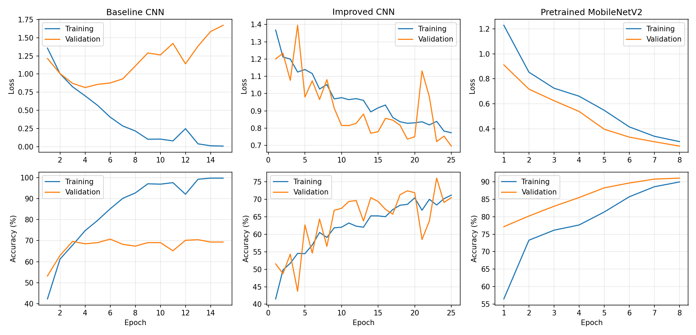

# Major Project: Waste Image Classification System

An application that classifies a photo of waste into one of five categories (**cardboard, glass, metal, paper, plastic**) and shows the predicted category with the model score. Three models are trained and compared: a baseline CNN, an improved CNN and a pretrained MobileNetV2. A Gradio web page lets anyone upload a picture.

> **Model scores do not guarantee correctness.** A score only shows how strongly the model prefers one category over the others. It is not the probability of being right. The evaluation report counts how many wrong test predictions still had a high score, and the model will always choose one of the five categories, even for an object that is not waste.

## Features
- Upload an image; the app applies exactly the same preprocessing as in training (resize, normalise) and shows the predicted category and score
- Warns when the score is below 60% ("not sure")
- Shows the predictions of the baseline, improved and pretrained models on the same image
- Duplicate-safe dataset split: exact duplicates removed, near-duplicate photos kept together in one split, then checked for leakage
- Confusion matrix, per-category results and error analysis ([evaluation_report.md](evaluation_report.md))

## Dataset
TrashNet (Thung and Yang, Stanford, 2016), https://github.com/garythung/trashnet. The `trash` category was left out because it is small and vague. See the evaluation report for the exact class counts and split sizes.

## How it works
| Step | File | What happens |
|---|---|---|
| 1. Organise data | `prepare_data.py` | Reads one folder per category, removes exact duplicates, groups near-duplicates with an image fingerprint (difference hash), splits 70/15/15 so that a group never crosses splits, and checks for leakage |
| 2. Preprocess | `common.py` | Resize to a square, convert to a tensor, normalise. Training adds random crop, flip, rotation and colour changes (augmentation); validation, test and the app never do |
| 3. Train | `train.py` | Trains the three models and keeps the best epoch of each (chosen on validation accuracy). The best model overall is saved as `final_model.pt` |
| 4. Evaluate | `evaluate.py` | Measures every model on the test set, draws the confusion matrix and failure examples, writes `evaluation_report.md` |
| 5. Predict | `predictor.py` | Loads the saved model and classifies one image |
| 6. Demo | `app.py` | Gradio interface |

## Run it
```
pip install -r requirements.txt
python prepare_data.py --source raw_dataset      # see "Get the dataset" below
python train.py
python evaluate.py
python app.py
```
Then open the address printed in the terminal (usually http://127.0.0.1:7860).

### Get the dataset
Download TrashNet, or any waste dataset with **one folder per category**, and unpack it so that the category folders (cardboard, glass, ...) are directly inside `raw_dataset/`. Then run `prepare_data.py` as above. An optional helper `python download_dataset.py` tries to fetch it from Hugging Face.

### Trained model
`final_model.pt` (the best model) and the three models in `models/` are included in this repository. To retrain, follow the steps above.

## Results
| Configuration | Input size | Augmentation | Epochs | Parameters | Training time | Best val. accuracy | Test accuracy |
|---|---|---|---|---|---|---|---|
| Baseline CNN | 128 px | No | 15 | 1,072,549 | 320 s | 70.8% | 69.6% |
| Improved CNN | 128 px | Yes | 25 | 390,181 | 1278 s | 76.0% | 74.9% |
| Pretrained MobileNetV2 (final model) | 224 px | Yes | 8 | 2,230,277 | 771 s | 91.1% | 89.7% |

| Category | Precision | Recall | Test images |
|---|---|---|---|
| Cardboard | 98.2% | 88.5% | 61 |
| Glass | 89.2% | 77.3% | 75 |
| Metal | 92.1% | 93.5% | 62 |
| Paper | 89.7% | 97.8% | 89 |
| Plastic | 82.3% | 90.3% | 72 |

Final model: **Pretrained MobileNetV2, 89.7% test accuracy** (37 wrong of 359). The training and test images never share a duplicate (leakage check: 0).




## Error analysis
The model made 37 mistakes on 359 test images. The most common were Glass predicted as Plastic (11 times), Cardboard predicted as Paper (6) and Plastic predicted as Glass (5). Glass accounts for 17 of the 37 mistakes. Glass and plastic bottles are often transparent, shiny and similarly shaped, so in a small photo they look alike; cardboard and paper are both flat, fibrous and similar in colour. 8 of the 37 mistakes had a score of 80% or more, so a high score does not mean the answer is correct.


## Conclusion
The pretrained MobileNetV2 was clearly the best model (89.7% test accuracy), 15 points above the improved CNN (74.9%) and 20 points above the baseline (69.6%). The baseline overfitted: its training accuracy reached about 99.8% while validation accuracy stayed near 69%. Augmentation, batch normalisation and dropout reduced this and gave about +5 points, but training from scratch on about 1,700 images is limited, whereas the pretrained model starts from features learned on millions of images.

## Limitations
- Small public dataset, mostly one object on a plain background; real photos with clutter, different lighting or several objects will be classified worse.
- Only five categories. Anything else (food, batteries, mixed objects) will still be forced into one of them.
- Scores are not calibrated and are not guarantees (see above).
- Photos are squeezed into a square, which distorts long objects.
- Recycling rules differ by place and depend on how clean the item is. This tool only looks at a picture and must not be the only basis for sorting decisions.

## Demo video
https://drive.google.com/file/d/1ksN5EtQoOhYCPBjDn0VArIITNBxAosIY/view?usp=sharing
